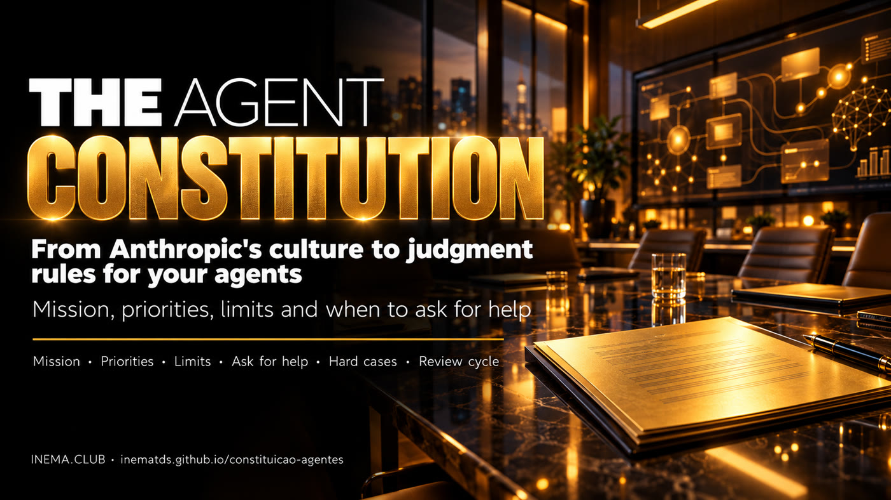

# 📜 Agents' Constitution

[](https://inematds.github.io/constituicao-agentes/guia/en/)

**🇧🇷 [Português](README.md) · 🇺🇸 [English](README.en.md) · 🇪🇸 [Español](README.es.md)**

## 🎓 Quick course

5 lessons of about 15 minutes: **https://inematds.github.io/constituicao-agentes-v62/en/**

## What it is

This project explains one idea: Anthropic attracts talent with purpose and autonomy, and it also writes a "constitution" that teaches Claude to decide when there is no ready-made rule. In both cultures, the goal is the same: to shape people who know how to judge, not just obey. Here you see what the data proves and what is still a hypothesis, and you get a kit to write the constitution of your company's AI agents. To use it, just read and fill in the template; the optional checker requires Python 3.

## 📖 User guide

Full guide (landing + step by step): **https://inematds.github.io/constituicao-agentes/guia/en/**

## What's here

The kit files are in Portuguese.

| File | What it is for |
|---|---|
| [`docs/LOGICA.md`](docs/LOGICA.md) | The analysis: two cultures, what the numbers prove, Maslow, Claude's constitution, training vs. context, the bridge to management |
| [`modelo/constituicao-modelo.md`](modelo/constituicao-modelo.md) | Template with 9 sections to fill in |
| [`modelo/prompt-rascunho.md`](modelo/prompt-rascunho.md) | Prompt for an AI assistant to make the first draft |
| [`modelo/casos-de-teste.md`](modelo/casos-de-teste.md) | 8 cases to test the agent before and after each version |
| [`exemplos/clinica-atendimento.md`](exemplos/clinica-atendimento.md) | Filled-in fictional example (clinic, WhatsApp customer service) |
| [`scripts/checar_constituicao.py`](scripts/checar_constituicao.py) | Checker: sections, hard cases, "Why" and brackets left to fill in |

## Quick start

```bash
git clone https://github.com/inematds/constituicao-agentes
cd constituicao-agentes
cp modelo/constituicao-modelo.md minha-constituicao.md
# fill it in (by hand or with the drafting prompt) and check:
python3 scripts/checar_constituicao.py minha-constituicao.md
```

## The cycle

```
Mission + Constitution + Context → Agents + Tools + Execution
→ Results + Evaluation → Feedback + Revision → new cycle
```

A change only goes in if the test cases do not get worse.

## Sources

SignalFire, State of Talent Report 2025 · [Claude's constitution](https://www.anthropic.com/constitution) (Anthropic, 01/22/2026, CC0).

---

Analysis by Nei Maldaner · [INEMA.CLUB](https://inema.club) · open and free content.
