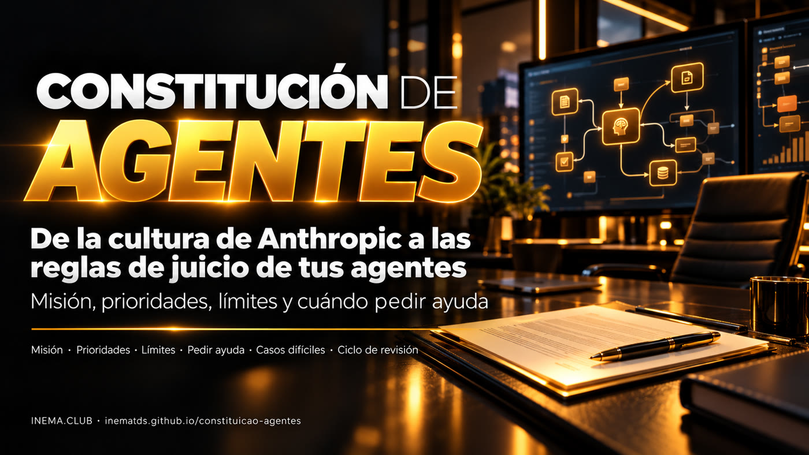

# 📜 Constitución de los Agentes

[](https://inematds.github.io/constituicao-agentes/guia/es/)

**🇧🇷 [Português](README.md) · 🇺🇸 [English](README.en.md) · 🇪🇸 [Español](README.es.md)**

## Qué es

Este proyecto explica una idea: Anthropic atrae talento con propósito y autonomía, y también escribe una "constitución" que enseña a Claude a decidir cuando no hay una regla lista. En las dos culturas el objetivo es el mismo: formar a quien sabe juzgar, no solo obedecer. Aquí ves qué prueban los datos y qué sigue siendo hipótesis, y recibes un kit para escribir la constitución de los agentes de IA de tu empresa. Para usarlo basta leer y completar la plantilla; el verificador opcional requiere Python 3.

## 📖 Guía de uso

Guía completa (landing + paso a paso): **https://inematds.github.io/constituicao-agentes/guia/es/**

## Qué hay aquí

Los archivos del kit están en portugués.

| Archivo | Para qué sirve |
|---|---|
| [`docs/LOGICA.md`](docs/LOGICA.md) | El análisis: dos culturas, qué prueban los números, Maslow, constitución de Claude, entrenamiento × contexto, el puente con la gestión |
| [`modelo/constituicao-modelo.md`](modelo/constituicao-modelo.md) | Plantilla en 9 secciones para completar |
| [`modelo/prompt-rascunho.md`](modelo/prompt-rascunho.md) | Prompt para que un asistente de IA haga el primer borrador |
| [`modelo/casos-de-teste.md`](modelo/casos-de-teste.md) | 8 casos para probar el agente antes y después de cada versión |
| [`exemplos/clinica-atendimento.md`](exemplos/clinica-atendimento.md) | Ejemplo ficticio completo (clínica, atención por WhatsApp) |
| [`scripts/checar_constituicao.py`](scripts/checar_constituicao.py) | Verificador: secciones, casos difíciles, "Por qué" y corchetes por completar |

## Uso rápido

```bash
git clone https://github.com/inematds/constituicao-agentes
cd constituicao-agentes
cp modelo/constituicao-modelo.md minha-constituicao.md
# completa (a mano o con el prompt-rascunho) y revisa:
python3 scripts/checar_constituicao.py minha-constituicao.md
```

## El ciclo

```
Misión + Constitución + Contexto → Agentes + Herramientas + Ejecución
→ Resultados + Evaluación → Retroalimentación + Revisión → nuevo ciclo
```

Un cambio solo entra si los casos de prueba no empeoran.

## Fuentes

SignalFire, State of Talent Report 2025 · [Constitución de Claude](https://www.anthropic.com/constitution) (Anthropic, 22/01/2026, CC0).

---

Análisis de Nei Maldaner · [INEMA.CLUB](https://inema.club) · contenido abierto y gratuito.
